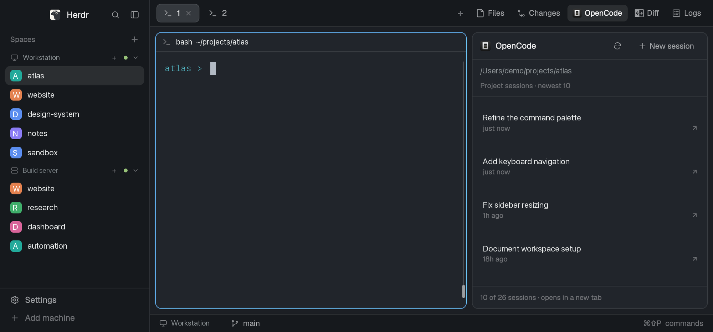

# OpenCode Panel for Herdr

A native Herdr panel for browsing and resuming OpenCode project sessions. It
connects to the background OpenCode 2.x service, follows the selected terminal's
directory, and refreshes the affected project's session metadata when sessions
are created, renamed, moved, or finish running. Open a session in a new tab or
start a fresh one without leaving Herdr.



## Install

Requires Herdr with the mod APIs described in its generated `AGENTS.md`, Bun,
and a running OpenCode 2.x background service. The client is pinned to 2.2.3;
the original installation was tested against service 2.2.5. Local filesystem
handling and the remote fallback currently assume macOS/Linux paths.

**Access disclosure:** this is trusted code. It runs Bun to start a local
adapter, makes authenticated HTTP requests to loopback and the discovered
OpenCode service, and reads OpenCode's service registration and local `.git`
metadata outside its folder. It writes private bridge registration beneath
Herdr's `data/` directory. Remote spaces run Git and the OpenCode CLI on their
machine through Herdr. Clicking a session starts the OpenCode CLI. It does not
query prompts/messages or provider credentials. The service event stream is
consumed using a metadata-event filter; this is not a server-side permission
boundary. Install only code you trust.

1. Read [RECIPE.md](RECIPE.md) and the source before installing.
2. Copy `mods/opencode-panel/` into `~/.config/herdr-app/mods/`. If that name
   exists, stop: do not overwrite it. Renaming also requires updating the asset,
   launcher and keybinding references.
3. Install the adapter dependencies:

   ```sh
   cd ~/.config/herdr-app/mods/opencode-panel/adapter
   bun install --frozen-lockfile
   ```

4. Run `herdr-app check ~/.config/herdr-app/mods/opencode-panel`.
   Herdr docks the newly discovered mod on the right at 360 logical pixels.
   No custom layout or toolbar mod is required.
5. Optionally merge the supplied `keys.json` binding into your existing file:
   **Ctrl-Shift-F12** toggles the panel. Ask before replacing an existing binding;
   never replace your whole keys file. The command palette's Open mod action
   also opens/closes `opencode-panel`.

Keep `RECIPE.md` and `preview.png` in the repository, not in Herdr's config home.
The preview is a real Herdr screenshot with opaque replacements for machine,
space, session and path text; the surrounding custom layout is illustrative,
not included in this mod.

## Service and updates

The panel lazily launches one persistent, authenticated loopback Bun bridge.
The official `@opencode/client/service` API discovers an existing compatible
service and supplies authentication; the bridge never starts, stops or upgrades
OpenCode itself. Start OpenCode normally if its service is not running. No token
needs to be pasted into mod files.

The event subscription invalidates the relevant project's cache when its session
changes, or all caches if the project cannot be identified. A cheap revision
request every two seconds triggers revalidation. Lists are also revalidated
after 30 seconds, with cached rows retained during refresh and service recovery.
This is a session-history browser, not an agent-status dashboard.

Checkout roots, nested package directories and sibling Git worktrees share the
API's project scope. Ten newest sessions appear initially; **Show more** adds 20
up to 1,000. Expansion is remembered per machine/project for this mod instance.
Remote Unix spaces use a cached `opencode session list` fallback instead of
sending remote paths to the local service; they do not receive live API events.

Runtime registration lives at `~/.config/herdr-app/data/opencode-panel/bridge.json`
(mode 0600, directory 0700). Never publish it: it contains a random bridge-only
token. The bridge binds `127.0.0.1` on an ephemeral port, rejects browser Origin
headers, authenticates every route and exits after five minutes without requests.
Hidden mod instances keep their gentle data polling until removed, so hiding is
not equivalent to shutting down the bridge.

For an alternate Herdr config home, set **both** `HERDR_APP_HOME` and
`HERDR_OPENCODE_ADAPTER_STATE="$HERDR_APP_HOME/data/opencode-panel"` in Herdr's
launch environment. `HERDR_OPENCODE_SERVICE_FILE` selects a nonstandard OpenCode
registration file. These are local runtime settings, not public config files.

## Development

```sh
herdr-app check mods/opencode-panel
node --test mods/opencode-panel/model.test.mjs mods/opencode-panel/panel.test.mjs
cd mods/opencode-panel/adapter
bun install --frozen-lockfile
bun test
```

Then try the mod in Herdr: the static check does not exercise later async states
or native layout. See [RECIPE.md](RECIPE.md) for visual and behavioral acceptance
checks and enough detail to rebuild from an empty folder.

## Credits

Independent community mod; not an official Herdr or OpenCode product.
The OpenCode logo (`mods/opencode-panel/opencode.png`) comes from the
[OpenCode desktop production icon](https://github.com/anomalyco/opencode/blob/dev/packages/desktop/icons/prod/64x64.png).
OpenCode's name and logo belong to their respective owners.
