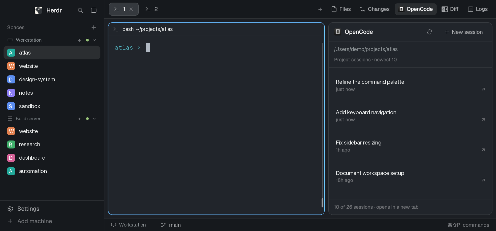

# OpenCode Panel

A native right-hand Herdr panel lists the selected terminal's OpenCode project
sessions, newest first. It talks to an already-running background OpenCode 2.x
service, updates its cached list as individual sessions change, and opens a
chosen session in a new terminal tab. A small header also offers Refresh and
New session. It is a reusable mod, not a replacement window layout.

## What you see

- A 360px-wide panel on the right by default. It fills the available height,
  has a 10px corner radius and a 1px border. Use the user's theme background,
  foreground and border colors rather than hardcoded screenshot colors.
- A fixed 42px header: 16px full-color OpenCode logo, semibold “OpenCode”,
  flexible space, a 32×32px icon-only Refresh button, and a 32px-high plus-icon
  “New session” button. Icons are 14px; buttons have 6px corners and 8px
  horizontal padding. Header padding is 12px, gaps 8px.
- A directory strip with 12px horizontal/8px vertical padding and a bottom
  border: the current absolute directory in muted 12px text, truncated with
  a full-path tooltip; below it, dim 11px “Project sessions · newest 10”.
  That subtitle remains unchanged when more rows are displayed.
- A vertically scrolling list, 8px padding, 4px gaps. Each whole row is a
  button, minimum 64px high, 8px padding, 6px corners. A single-line 13px title
  sits over dim 11px relative age and a right-aligned ↗. If its recorded directory
  differs from the current directory (ignoring trailing slashes), add that path
  as another truncated dim 11px line. Row tooltips include full title, directory,
  session ID and localized update time.
- Ten skeleton rows on the first uncached load: two rounded raised-color bars
  per row, 12px and 10px high, varied widths. Empty/loading/error states occupy
  the same list region. Errors use the theme's red ANSI color.
- “Show more” after the rows when older sessions are available. A fixed footer
  has a top border, 12px horizontal/8px vertical padding, dim 11px text:
  “10 of 26 sessions · opens in a new tab”, or “10+ sessions…” if history is not
  exhausted. At the limit show “Showing the newest 1,000 sessions.”

The preview's sidebar and terminal are context from a personal layout, not
parts to recreate. Its machine/space/session labels and paths are anonymized.

## How it behaves

- Follow the active space, active tab and focused terminal's live directory;
  fall back to a terminal with a directory in that tab. Selecting a different
  split terminal or changing directory changes the project context. No terminal
  means “Select a terminal to see its sessions.” and disabled header actions.
- Show the newest ten non-archived, top-level sessions, ordered by update time
  descending with ID as tie-breaker. Do not filter by age or exact directory:
  checkout-root and sibling-worktree sessions belong in the same project list.
- Clicking a row opens a new tab in the current space, using that session's
  recorded directory and title, and resumes precisely that session. It does
  not send a prompt. New session opens a fresh OpenCode tab at the current
  directory, with no continuation/session flag. Neither action closes the panel.
- Refresh forces a fresh list; while pending, disable Refresh and show its
  loading tooltip. New session stays available when there is a directory.
  Show more adds 20 visible rows, fetches older pages if needed, and retains
  expansion when returning to the same machine/project. Maximum: 1,000.
- Reuse cached rows immediately, including empty lists. Only uncached contexts
  get skeletons. Refresh failures keep existing rows and show an error; an
  uncached failure says “Use Refresh to try again.” A late reply from a previous
  project must never replace the currently selected project's rows.
- A background event subscription marks the affected project's session list
  dirty for creation, rename, move, deletion, archive/unarchive, fork and
  execution start/success/failure/interruption. Unknown project or reconnect
  invalidates all projects without discarding rows. Revision checks every two
  seconds and a 30-second stale deadline pick up these changes. These are list
  updates, not per-message streaming or a status indicator.
- Working, blocked, done and idle agents all have the **same row appearance**:
  this panel does not read Herdr agent statuses, show status dots, or mark a
  session as seen. It shows titles and update ages only.
- Buttons have native hover, keyboard-focus and pressed backgrounds, accessible
  labels and tooltips. Directional pane navigation can focus the panel. Optional
  Ctrl-Shift-F12 toggles a 360×640px dialog copy (not a docked block); there are no panel-specific keyboard commands beyond
  receiving focus. No dragging, animation or periodic spinner redraws.

## Built from

Create only `mods/opencode-panel/`, optional root `keys.json`, this recipe and
`preview.png` in one repository root. Add installation notes in `README.md`.
Do not ship a `layouts/` folder, private runtime state, installed dependencies,
or generated Herdr declaration/config files.

### Native mod

- `mod.json`: `{"place":"right","size":360,"title":"OpenCode sessions","focusable":true,"overlay":{"width":360,"height":640}}`.
  Herdr docks it when first discovered. No custom block IDs, toolbar mod,
  shipped mod imports, or layout-node tree are required. It accepts no custom
  props; its context comes from live Herdr data.
- `main.js`: default-export a `View` subclass from `gpui-kit`; build elements
  with `div`, `svg`, `image`, and `gpui-base`'s `Button`, `h_flex`, `v_flex`.
  Consult the installed `gpui-kit.d.ts` and `herdr.d.ts` for exact APIs. Use
  `spaces`, `panes`, `focused`, `theme`, `run`, `exec`, `notify`, `nextCommand`.
  Create a focus handle in `init`, track it on the root, and focus it when
  `nextCommand()` yields `"focus"`. Use fresh callback contexts, never retained
  `cx` references. `render` only describes elements; no async work or notifications.
- A 150ms timer checks navigation in memory. It starts no subprocess/network
  request at that rate. Initiate snapshots only for unresolved/absent projects,
  changed revisions, manual refresh, pagination or 30-second staleness; back
  off failures for five seconds. Deduplicate in-flight snapshots by machine,
  directory and requested count. Notify only for meaningful changes/current
  context; returning identical snapshots preserves existing row objects.
- `model.js`: normalize remote CLI records, reject malformed/duplicate session
  IDs, supply “Untitled session”, sort by update time then ID, format ages as
  “just now”, “5m ago”, “2h ago”, “1d ago”. Resume with
  `run("tab.new", {space, folder: session.directory, name: session.title,
  argv: ["opencode", "--session", session.id]})`. New uses
  `{space, folder: cwd, name: "OpenCode", argv: ["opencode"]}`. Launch errors
  use an error notification. Use argument arrays, not shell interpolation.
- `projects.js`: per-instance view cache keyed by machine/API project ID, with
  directory mappings, optimistic longest-root hints and expansion counts.
  Bound entries to 32 projects and hint maps to 512. Confirm unseen directories
  with the adapter so nested repositories do not permanently inherit a parent's
  cached list.
- `bridge.js`: use Herdr `exec` with `--version` to probe `bun` on PATH, then
  `home()+"/.bun/bin/bun"`, then `node` on PATH. Skip only executables that cannot
  start; a nonzero version check fails, and Node must report version 22 or newer.
  Run `appHome()+"/mods/opencode-panel/adapter/launch.mjs"` with the first available
  supported runtime. Once selected, a failed adapter launch must not fall back
  to another runtime and hide a dependency/startup error. Read and validate the private
  registration at `appHome()+"/data/opencode-panel/bridge.json"` using
  `readTextFile`; require version 1, a valid port and a 64-hex-character token.
  Cache the endpoint; authenticated `fetch` calls use `/snapshot` and `/revision`.
  Rediscover/retry once on transport failure or HTTP 401.
- Art: bundle `opencode.png`, the OpenCode desktop production logo linked in
  README, and simple `plus.svg`/`refresh.svg` icons. Image paths are relative to
  Herdr's config home: `mods/opencode-panel/...`; the logo is not theme-tinted.
- Optional key snippet: global `ctrl-shift-f12` maps to
  `{"command":"mod.open","args":{"name":"opencode-panel"}}`.

### Background adapter

Support Bun and Node.js 22+ using pinned `@opencode/client` 2.2.3 and committed
`package.json`, `bun.lock` and `package-lock.json`. Install with either
`bun install --frozen-lockfile` or `npm ci`. Keep both lockfiles' dependency
versions synchronized. The adapter is separate from Herdr's JavaScript runtime,
so Node filesystem, HTTP, process, timer and crypto APIs belong here, never in
native UI code. Keep the common discovery/cache/lifecycle code portable, using
`node:timers/promises` for sleep, `node:child_process` for spawning, and
`fileURLToPath`/`import.meta.url` for module paths. Use Bun's native HTTP server
when running under Bun; do not route it through Node's compatibility server.
Tests use `node:test` and `node:assert/strict` and run under both runtimes.

- `http-handler.mjs`: one shared request handler owns constant-time bearer auth,
  Origin/loopback-host checks, routing, input validation and sanitized replies.
  It accepts a native Request or an object with `url`, `method`, `Headers` and
  a bounded `json()` reader, plus the listening port. Return standard Responses.
- `http-bun.mjs`: a small `Bun.serve` adapter with loopback binding, ephemeral
  port and native `maxRequestBodySize: 4096`. Pass native Requests straight to
  the shared handler. Set `development: false` and a sanitized error callback
  so an exception cannot expose Bun's debug page. Use `server.stop(true)`.
- `http-node.mjs`: only the Node fallback imports `node:http`. Bound incoming
  request streams to 4KiB, including chunked bodies; translate the minimal
  request interface and shared Responses to Node's HTTP objects. Handle client
  disconnects without crashing. Expose the same `{port, stop}` interface.
- `server.mjs` dynamically imports only the active runtime's HTTP adapter;
  a Bun transport failure must not silently load the Node transport. Hash both
  adapters and the shared handler as part of the bridge build ID.
- `upstream.mjs`: import `OpenCode` from `@opencode/client` and `Service` from
  `@opencode/client/service`. `Service.discover({version: v => v.startsWith("2.")})`
  locates an existing service; `Service.headers(endpoint)` provides auth to
  `OpenCode.make({baseUrl: endpoint.url, headers})`. Never call ensure/start/stop
  on OpenCode. Support `HERDR_OPENCODE_SERVICE_FILE`. Rediscover after failures.
  Consume filtered session/project/worktree events plus `server.connected`;
  resubscribe after a one-second delay on disconnect. Do not log SDK errors or
  credentials, and do not call message/prompt APIs.
- `roots.mjs`: resolve the physical directory and walk ancestors using filesystem
  metadata to the nearest `.git` file/directory, including worktrees and nested
  repos. Otherwise treat that directory as its own root. No local Git subprocess.
- `cache.mjs`: resolve `client.location.get({location:{directory}})` to the API
  project; cache checkout resolution for 60 seconds. Share one project cache
  across checkouts. List with `client.session.list({project: projectID,
  parentID:null, archived:false, order:"desc", limit, cursor?})`. Normalize
  `id`, `title`, `location.directory`, `time.updated` and `time.created`; no
  message bodies. Prefetch 30 rows, use cursor pages of at most 100, preserve
  larger requested history on refresh, and reject repeated cursors. Deduplicate
  resolution and list work; retain rows on failure, retry after five seconds,
  and bump a revision after invalidation/load. Bound to 32 project caches and
  512 root hints. Expose sanitized errors only.
- `runtime.mjs`, `launch.mjs`, `server.mjs`: hash adapter sources to identify
  builds. Reuse a healthy matching bridge; serialize startup with a directory
  lock, recover locks older than 30 seconds, replace only an older bridge,
  and wait up to ten seconds for readiness. Detach one server with
  `process.execPath`, preserving the launcher's runtime; convert the module URL
  with `fileURLToPath` so paths with spaces/special characters work. Surface
  child-spawn errors. Reuse a healthy build even if a different supported runtime
  launched it. Default state
  is the Herdr `data/opencode-panel/` sibling of `mods/`, overridable with
  `HERDR_OPENCODE_ADAPTER_STATE`. Atomic registration contains version, build,
  PID, port and a random 32-byte hex bridge-only token, file 0600/directory 0700.
  Bind only `127.0.0.1:0`, reject Origin headers/non-loopback hosts, compare
  Bearer authorization in constant time, mark replies `no-store`, limit bodies
  to 4KiB, including chunked request bodies; return 413 for oversized bodies.
  Malformed JSON returns 400. Client disconnects must not terminate the bridge.
  Authenticated routes: GET `/health`, `/revision`, `/metrics`; POST
  `/snapshot` with absolute directory, integer limit 1–1000 and boolean force;
  POST `/shutdown`. Never expose upstream credentials. Shut down after five
  minutes without requests; never shut down OpenCode. Metrics contain counters
  only. Clean registration on shutdown only if it still belongs to this PID.

For remote Unix spaces, call Herdr `exec` with `{cwd, on: machine}` for
`git rev-parse --path-format=absolute --git-common-dir --show-toplevel` then
`opencode session list --format json --max-count N`. Cache for 30 seconds,
sort/normalize the returned project scope, and never send remote paths to the
local API. This is a CLI fallback, not a deployed remote bridge.

## Watch out

- Herdr mods have no DOM, CSS, Node APIs or browser timers. Use native controls
  and Herdr task/timer APIs; a passing static check does not prove async UI works.
- Do not retain the original personal layout's `panel`/`panel-body` visibility
  assumptions. The portable mod must work without those IDs. Its timers run
  while hidden; revision polling continues, so the bridge stays alive while
  the instance still requests data. Multiple copies have independent view caches
  but share the local bridge.
- Give the optional dialog explicit overlay width/height: an unconstrained
  dialog collapses the flex-based session list to zero height despite loading
  its data correctly. Open mod opens a dialog, not a dock toggle.
- Requires Bun or Node.js 22+ and an already-running compatible OpenCode 2.x service. Do not
  replace discovery with a hardcoded port or publish service auth. The bridge's
  metadata-only surface is not an upstream authorization sandbox.
- With alternate `HERDR_APP_HOME`, set `HERDR_OPENCODE_ADAPTER_STATE` to its
  `data/opencode-panel` too; the native reader and adapter writer must agree.
  Installing via a symlink can also affect relative state paths; configure the
  explicit state directory if using a source-controlled symlink later.
- Unix absolute paths only; Windows/remote bridge deployment are not supported.
  Remote CLI behavior depends on the OpenCode version installed there. No live
  remote events, active-status badges, prompt editor, rename/delete controls,
  search, session previews or automatic installation of dependencies.
- The panel's retained expansion is in memory, not persistent across restart.
  Relative ages update on redraws, not a dedicated clock timer. Very narrow
  docks may truncate header controls; use the default 360px or wider.
- Keep runtime registrations, logs, local configs, `node_modules` and original
  private screenshots out of Git. Publish only an opaque-anonymized PNG, not
  text overlays that leave original letters visible.

## Done when

1. `herdr-app check mods/opencode-panel` passes. After installing dependencies,
   all `*.test.mjs` files in the mod and adapter pass under both
   `bun test mods/opencode-panel` and
   `node --test mods/opencode-panel/*.test.mjs mods/opencode-panel/adapter/*.test.mjs`.
   Clean `npm ci` and `bun install --frozen-lockfile` installations both work.
   Test Node.js 22, 24 and 26 plus Bun 1.4.4. Prove Bun preference, home-Bun
   fallback, Node-only startup, unsupported/missing runtime errors and no fallback
   after adapter failure. Detached startup/reuse tests use isolated state and an
   absent upstream service file, never the owner's live bridge.
2. In Herdr it docks at the right without a supplied layout. The optional merged
   shortcut toggles a correctly sized dialog copy; directional pane navigation
   can focus native controls in the dock.
3. An uncached project shows skeletons, then up to ten ordered sessions (even if
   all are old). Empty/no-terminal/error states are legible in light/dark themes.
4. Split focus and changing directories follow the right project. Package
   subdirectories and sibling worktrees reuse API project history; nested repos
   resolve separately. Returning to a cached project has no skeleton flash or
   stale-response takeover.
5. Create/rename/complete a session externally: its project list revalidates via
   the event/revision path. Disconnect the service: cached rows remain with a
   sanitized error; reconnect/Refresh recovers without copying credentials.
6. Show more reveals 20 older rows at a time, retains expansion on navigation,
   uses cursor pagination locally, and stops at exhaustion or 1,000 rows.
7. Clicking a session issues the exact new-tab resume arguments; New session
   issues no session ID. Header buttons, tooltips and row keyboard focus work.
8. Bridge security tests reject missing authorization, browser Origins and
   relative directory requests. Runtime files remain private/ignored. The repo
   contains the mod, recipe and anonymized `preview.png`, with no `layouts/`.
